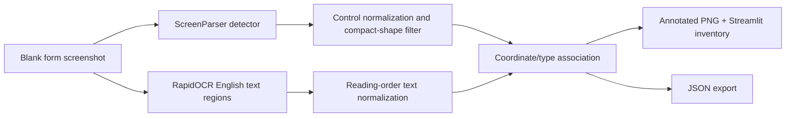

# FormLens Final Submission

## Abstract

FormLens is a local screenshot-based form-field analysis application. It combines the pretrained ScreenParser detector with RapidOCR and a coordinate-aware association layer to identify visual controls, read nearby labels, and export a reviewable JSON field inventory. Inference runs on the user's Mac without cloud APIs, a database, browser extension, local language model, training data, or fine-tuning.

## Problem statement

Blank forms expose their structure visually rather than through a DOM. FormLens recovers controls, labels, control types, and confidence information from a screenshot while preserving evidence for human review.

## Frozen architecture



## Reproducible demonstration

```bash
cd /Users/vibhor/Downloads/MLP
source .venv/bin/activate
streamlit run app.py
```

Upload a PNG/JPG/WEBP form screenshot and use the PNG/JSON download buttons. The checkpoint is `models/ScreenParser/best.pt`; RapidOCR weights are cached inside the isolated environment.

## Evaluation evidence

- `evaluation/REPORT.md`: synthetic development set; it was used for rule development.
- `evaluation/holdout/REPORT.md`: independent synthetic holdout evaluated after tuning, without post-hoc changes.
- `evaluation/real_world/REPORT.md`: five-form robustness check using official blank forms and the frozen pipeline.

These results are separate and must not be pooled. The real-world experiment shows domain shift from screenshot-like UI controls to dense paper-form layouts.

## Limitations and submission boundary

ScreenParser is a pretrained detector, not a model trained for this project. Performance is weaker on scanned/paper forms, dense tables, barcodes, handwriting, filled forms, and labels embedded in instructional prose. Feature development is frozen; browser autofill, training, fine-tuning, additional models, cloud inference, and database workflows are outside this submission.
