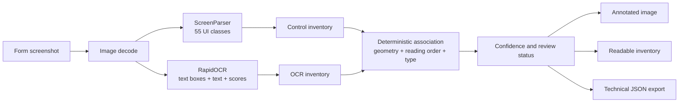

# FormLens Phase 3 Submission Deliverables

## Abstract

FormLens is a local screenshot-analysis application that identifies visible form controls, reads nearby labels, and associates labels with controls without training a new model or sending screenshots to a cloud service. It combines the pretrained ScreenParser UI detector with local RapidOCR and a deterministic spatial matching layer. A Streamlit interface presents annotated results, confidence values, review flags, and JSON metadata. On a ten-image development set, the pipeline achieved 98.2% detection precision, 100.0% recall, 99.1% F1, and 100.0% label-association accuracy after development tuning. An independent ten-image synthetic holdout achieved 94.0% precision, 100.0% recall, 96.9% F1, 91.5% label-association accuracy, and 100.0% exact OCR label coverage. These results indicate strong performance on the tested synthetic layouts, while not establishing generalization to real-world scanned forms, native applications, handwriting, or unseen languages.

## Problem statement

Forms may contain visual controls whose labels are not reliably exposed through accessible HTML metadata. The project asks whether a screenshot can be converted into a useful, inspectable inventory of controls and nearby labels using pretrained inference and lightweight deterministic association rather than model training or a cloud API.

## Scope and contribution

The contribution is an integration and evaluation workflow:

1. ScreenParser detects visual controls and returns boxes, classes, and detector confidence.
2. RapidOCR detects and recognizes visible text locally.
3. A deterministic matcher uses geometry, reading order, and control type to propose label associations.
4. Streamlit exposes annotated images, filters, confidence values, review flags, and JSON export.

No FormLens model was trained or fine-tuned. ScreenParser and RapidOCR are pretrained models used for local inference.

## System architecture



## Association algorithm

For each detected control, candidate OCR labels are scored using:

- text above the control with horizontal alignment;
- text to the left for conventional label/control layouts;
- text to the right for compact checkboxes, radio buttons, switches, and toggles;
- a small type compatibility bonus for date, checkbox, and select labels;
- one-to-one greedy assignment so a label cannot be reused;
- acceptance at match score >= 0.45;
- `Matched` at score >= 0.70, `Uncertain` below 0.70, and `Unmatched` when no candidate is accepted.

Compact controls are filtered when their predicted box aspect ratio exceeds 1.8 in either direction, reducing duplicate boxes that include adjacent text.

## Evaluation methodology

The development benchmark contains 10 manually generated screenshots and 54 ground-truth controls. The original set was used for rule tuning and is therefore explicitly a development set. The independent holdout contains 10 newly generated screenshots and 47 ground-truth controls. It was evaluated with the frozen configuration in `evaluation/holdout/config.json`; no post-hoc tuning was performed.

Detection matching requires identical normalized control type and IoU >= 0.50. Precision, recall, and F1 are computed over controls. OCR coverage is computed independently over all ground-truth labels. Label-association accuracy is computed only over IoU-matched detections and counts missing or wrong labels as incorrect.

## Results

### Development set (tuned; not independent)

| Metric | Result |
|---|---:|
| Controls | 54 |
| Predictions | 55 |
| Precision | 98.2% |
| Recall | 100.0% |
| F1 | 99.1% |
| Association accuracy | 100.0% |
| Exact OCR label coverage | 100.0% |

### Independent holdout (frozen)

| Metric | Result |
|---|---:|
| Controls | 47 |
| Predictions | 50 |
| Precision | 94.0% |
| Recall | 100.0% |
| F1 | 96.9% |
| Association accuracy | 91.5% |
| Exact OCR label coverage | 100.0% |

Per-screenshot tables and representative failure cases are preserved in [the development report](../evaluation/REPORT.md) and [the independent holdout report](../evaluation/holdout/REPORT.md).

## Representative failures

The development run initially produced duplicate compact-control regions; the geometry filter removed those duplicates. The frozen holdout still produced three false positives, including an extra `search_input` prediction in a select/radio layout. It also produced wrong associations in a dense radio group and once attached a section instruction to a select. These are included in the holdout report and demonstrate why OCR coverage alone is not sufficient evidence of correct field association.

## Limitations

- Both sets are synthetic screenshots, not a representative sample of deployed websites.
- No claim is made for scanned paper forms, handwriting, native desktop interfaces, severe compression, or non-English scripts.
- Holdout size is small; confidence intervals and broad demographic/layout coverage are not established.
- Greedy spatial matching can fail when controls are densely packed or section headings are near controls.
- The detector is pretrained inference, not a FormLens-trained detector.
- Browser DOM reconciliation and autofill are outside this phase.

## Setup and demonstration

```bash
cd /Users/vibhor/Downloads/MLP
.venv/bin/streamlit run app.py
```

Upload a PNG, JPEG, or WebP screenshot at `http://localhost:8501`, select a detector threshold, inspect the original or annotated image, filter the inventory, and download PNG/JSON results.

To reproduce the evaluations:

```bash
.venv/bin/python evaluation/run_evaluation.py
.venv/bin/python evaluation/run_holdout.py
```

The holdout command must be treated as a final validation run. If rules are changed after inspecting it, create and evaluate a new independent holdout set.

## Viva questions

1. What is the difference between pretrained inference and training from scratch in FormLens?
2. What does an object detector return, and why does ScreenParser not replace OCR?
3. How do bounding boxes and IoU determine a detection true positive?
4. Why can precision and recall move in opposite directions when changing the detector threshold?
5. Why is F1 useful when both missed controls and false detections matter?
6. How is OCR label coverage different from label-association accuracy?
7. Why can perfect OCR coverage coexist with incorrect form-field mappings?
8. Why are checkbox and radio groups difficult for greedy geometric matching?
9. What is the effect of the compact-control aspect-ratio filter?
10. Why must the original 10-image result be called a development-set result?
11. What makes the 10-image holdout independent, and what would invalidate that independence?
12. What assumptions are made by the one-to-one label assignment?
13. How would you design a confidence interval or larger benchmark for a stronger claim?
14. What changes would be required for Hindi, handwriting, or scanned documents?
15. Why is browser autofill a separate safety and evaluation problem?
